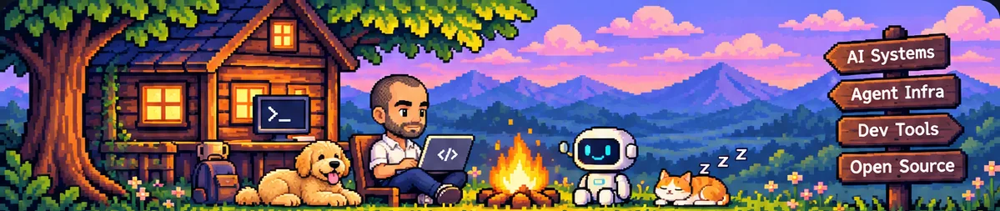
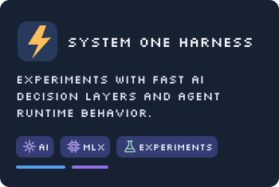
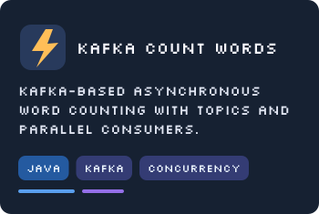
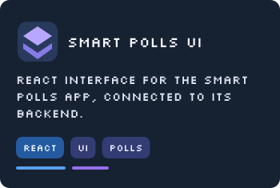
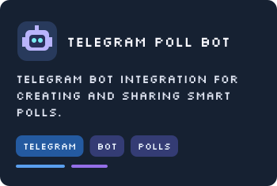
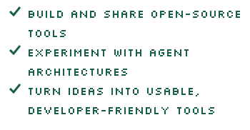

<!-- GENERATED FILE. Edit data/profile.json or data/projects.json, then run npm run build. -->

<picture><source media="(max-width: 600px) and (prefers-color-scheme: dark)" srcset="assets/generated/identity-dark.svg" /><source media="(max-width: 600px)" srcset="assets/generated/identity-light.svg" /><source media="(prefers-color-scheme: dark)" srcset="assets/generated/identity-desktop-dark.svg" /></picture>

 

<picture><source media="(prefers-color-scheme: dark)" srcset="assets/generated/heading-projects-dark.svg" /></picture>

<a href="https://github.com/SharonLanger/agent-playbook" aria-label="Agent Playbook repository"><picture><source media="(max-width: 600px)" srcset="assets/generated/agent-playbook-mobile.svg" /></picture></a> &nbsp;&nbsp; <a href="https://github.com/SharonLanger/claude-backstage" aria-label="Claude Backstage repository"><picture><source media="(max-width: 600px)" srcset="assets/generated/claude-backstage-mobile.svg" /></picture></a>

<a href="https://github.com/SharonLanger/system-one-harness" aria-label="System One Harness repository"><picture><source media="(max-width: 600px)" srcset="assets/generated/system-one-harness-mobile.svg" /></picture></a> &nbsp;&nbsp; <a href="https://github.com/SharonLanger/repo-probe" aria-label="Repo Probe repository"><picture><source media="(max-width: 600px)" srcset="assets/generated/repo-probe-mobile.svg" /></picture></a>

<a href="https://github.com/SharonLanger/kafkaCountWords" aria-label="Kafka Count Words repository"><picture><source media="(max-width: 600px)" srcset="assets/generated/kafka-count-words-mobile.svg" /></picture></a> &nbsp;&nbsp; <a href="https://github.com/SharonLanger/cacheserver" aria-label="Cache Server repository"><picture><source media="(max-width: 600px)" srcset="assets/generated/cache-server-mobile.svg" /></picture></a>

<a href="https://github.com/SharonLanger/smart-polls-react" aria-label="Smart Polls UI repository"><picture><source media="(max-width: 600px)" srcset="assets/generated/smart-polls-react-mobile.svg" /></picture></a> &nbsp;&nbsp; <a href="https://github.com/SharonLanger/TelegramPollBot" aria-label="Telegram Poll Bot repository"><picture><source media="(max-width: 600px)" srcset="assets/generated/telegram-poll-bot-mobile.svg" /></picture></a>

<a href="https://github.com/SharonLanger/smart-polls-backend" aria-label="Smart Polls Backend repository"><picture><source media="(max-width: 600px)" srcset="assets/generated/smart-polls-backend-mobile.svg" /></picture></a>

<picture><source media="(prefers-color-scheme: dark)" srcset="assets/generated/heading-about-dark.svg" /></picture>

<picture><source media="(prefers-color-scheme: dark)" srcset="assets/generated/about-dark.svg" /></picture> <picture><source media="(prefers-color-scheme: dark)" srcset="assets/generated/checklist-dark.svg" /></picture>

<picture><source media="(prefers-color-scheme: dark)" srcset="assets/generated/heading-tools-dark.svg" /></picture>

         

<!-- Generated with local TypeScript; see CONTRIBUTING.md for editing instructions. -->
