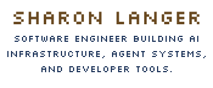
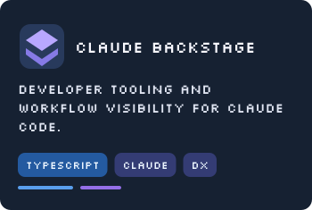
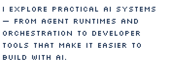

<!-- GENERATED FILE. Edit data/profile.json or data/projects.json, then run npm run build. -->

<picture><source media="(prefers-color-scheme: dark)" srcset="assets/generated/identity-dark.svg" /></picture>

 

<picture><source media="(prefers-color-scheme: dark)" srcset="assets/generated/heading-projects-dark.svg" /></picture>

  

<picture><source media="(prefers-color-scheme: dark)" srcset="assets/generated/heading-about-dark.svg" /></picture>

<picture><source media="(prefers-color-scheme: dark)" srcset="assets/generated/about-dark.svg" /></picture> <picture><source media="(prefers-color-scheme: dark)" srcset="assets/generated/checklist-dark.svg" /></picture>

<picture><source media="(prefers-color-scheme: dark)" srcset="assets/generated/heading-tools-dark.svg" /></picture>

         

<!-- Generated with local TypeScript; see CONTRIBUTING.md for editing instructions. -->
