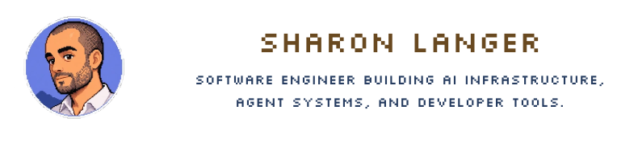
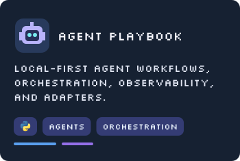
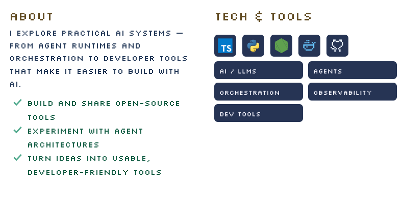
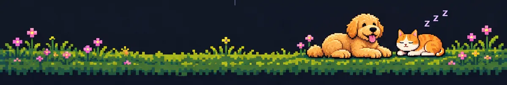

<!-- GENERATED FILE. Edit data/profile.json, data/projects.json, or data/icons.json, then run npm run build. -->

<picture><source media="(max-width: 600px) and (prefers-color-scheme: dark)" srcset="assets/generated/identity-dark.svg" /><source media="(max-width: 600px)" srcset="assets/generated/identity-light.svg" /><source media="(prefers-color-scheme: dark)" srcset="assets/generated/identity-desktop-dark.svg" /></picture>

 

<picture><source media="(prefers-color-scheme: dark)" srcset="assets/generated/heading-projects-dark.svg" /></picture>

 &nbsp;&nbsp; 

<picture><source media="(max-width: 600px) and (prefers-color-scheme: dark)" srcset="assets/generated/profile-info-mobile-dark.svg" /><source media="(max-width: 600px)" srcset="assets/generated/profile-info-mobile-light.svg" /><source media="(prefers-color-scheme: dark)" srcset="assets/generated/profile-info-desktop-dark.svg" /></picture>

<!-- Generated with local TypeScript; see CONTRIBUTING.md for editing instructions. -->
