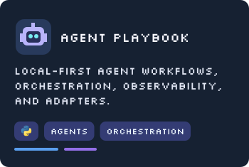
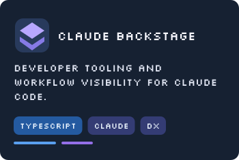
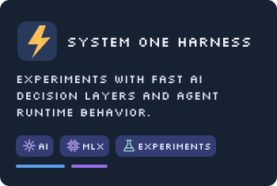
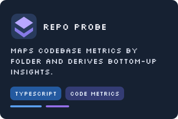
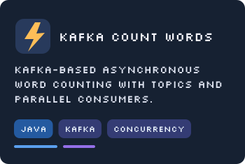
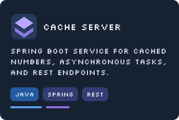
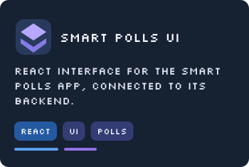
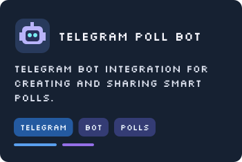
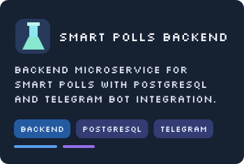

# In-place gallery preview

<a href="#pair-2">Next pair →</a>

● Page 1 of 5 · Agent Playbook + Claude Backstage

 &nbsp;&nbsp; 

● Page 2 of 5 · System One Harness + Repo Probe

 &nbsp;&nbsp; 

● Page 3 of 5 · Kafka Count Words + Cache Server

 &nbsp;&nbsp; 

● Page 4 of 5 · Smart Polls UI + Telegram Poll Bot

 &nbsp;&nbsp; 

● Page 5 of 5 · Smart Polls Backend

