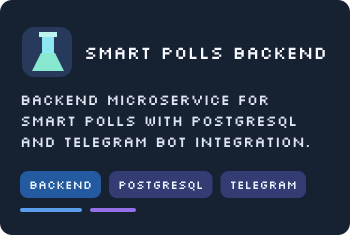

<!-- GENERATED FILE. Edit data/profile.json or data/projects.json, then run npm run build. -->

<picture><source media="(prefers-color-scheme: dark)" srcset="../assets/generated/heading-projects-dark.svg" /></picture>

 &nbsp;      &nbsp; 

